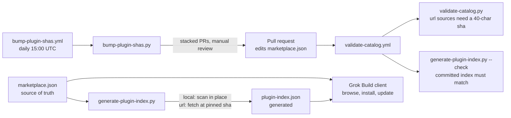

# Architecture

This page describes how the catalog, its generated index, the scripts and the CI workflows fit together. It describes
the repository as of commit `98d4056`; the scripts and workflows are the source of truth.



## Files

| Path | Role |
|---|---|
| `.grok-plugin/marketplace.json` | The catalog: one entry per plugin (`name`, `source`, optional `description`, `category`, `homepage`, `keywords`, `domains`). Hand-edited. |
| `.grok-plugin/plugin-index.json` | Generated list of what each plugin ships (skills, commands, agents, MCP servers, hooks, LSP servers). Deterministic output; never hand-edited. For url sources it records the pinned `sha` it was generated from. |
| `external_plugins/<name>/` | Vendored third-party plugins referenced by `source.path`. |
| `plugins/` | Reserved for first-party plugins; contains only `.gitkeep`. |
| `scripts/validate-catalog.py` | Fails if a url-sourced entry lacks a `sha`, if the `sha` is not 40 lowercase hex characters, or if an optional `path` is absolute, contains `..` or backslashes. Reads `.grok-plugin/marketplace.json` and, if present, `.claude-plugin/marketplace.json`. |
| `scripts/generate-plugin-index.py` | Rebuilds the index. Local sources are scanned in place; url sources are shallow-fetched at the pinned `sha`. `--check` exits non-zero if the committed file differs. |
| `scripts/plugin_catalog.py` | Shared extraction: reads a plugin manifest (`.grok-plugin/`, `.cursor-plugin/` or `.claude-plugin/` `plugin.json`) and scans components. Applies size limits (50 items per category, 120-character strings, 64 KiB per text read, 1 MiB per JSON file) and retries fetches three times. |
| `scripts/bump-plugin-shas.py` | Finds url pins whose upstream HEAD moved and whose manifest version changed (or neither has a version), updates the pin, regenerates the index and opens pull requests. Only `github.com`, `gitlab.com` and `bitbucket.org` hosts are allowed. Supports `--dry-run`, `--force` and `--only NAME`. |

## CI

- `.github/workflows/validate-catalog.yml` runs on pull requests, pushes to `main` and manual dispatch. It runs
  `validate-catalog.py` and `generate-plugin-index.py --check` with read-only permissions and Python 3.11. Actions are
  pinned by commit SHA.
- `.github/workflows/bump-plugin-shas.yml` runs daily at 15:00 UTC (7am Pacific) and on manual dispatch, on the runner
  label `ubuntu-latest-m`. It opens one daily pull request to `main` plus one stacked pull request per bumped plugin,
  then dispatches the validate workflow on each branch, because pull requests opened with `GITHUB_TOKEN` do not trigger
  `on: pull_request`. There is no auto-merge; the workflow comments say review is manual. If `bump/daily-YYYY-MM-DD`
  already exists the run does nothing unless `force` is set.

## Why pins are SHAs

An unpinned url source would let an upstream force-push or compromise reach every installer silently. The validator
enforces a full commit SHA at catalog level, and the README states that Grok Build re-checks `git rev-parse HEAD`
against the pin after cloning. That client behavior is stated in the README; it is not implemented in this repository.

## Run the checks locally

```bash
python3 scripts/validate-catalog.py
python3 scripts/generate-plugin-index.py --check   # fetches every pinned remote source, so it needs network access
python3 scripts/bump-plugin-shas.py --dry-run      # no push, no pull request
```
